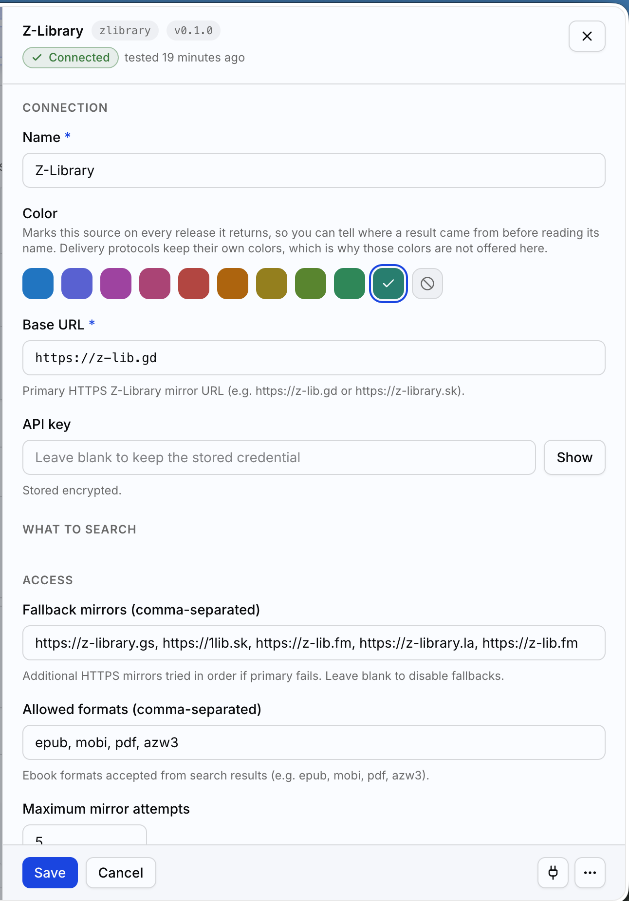
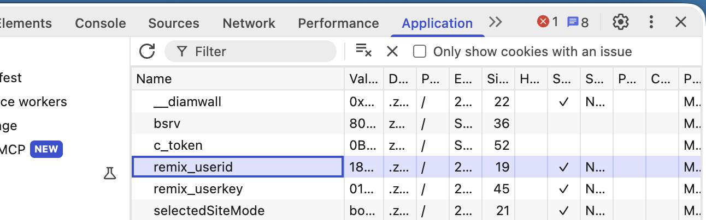

# Z-Library plugin for BookOrbit

Search Z-Library for ebooks using your account.
Supports BookOrbit plugin API v1.



## Install

1. Download [`index.mjs`](index.mjs) and load it through your BookOrbit deployment's plugin loader.
2. Go to settings > requests > plugins > install plugin and point it to the `index.mjs`.
3. In **BookOrbit**, enter your account's `remix_userid` and `remix_userkey` in
   the credential field as `userid:userkey` (numeric ID, then 32-character hex key).
   Example with fake values:
   ```text
   1234567:0123456789abcdef0123456789abcdef
   ```

   > You can find your credentials in your browser's developer tools after logging in as cookies:
   >
   > 

4. Set a trusted HTTPS mirror and review the fallback mirrors below.
5. Run BookOrbit's connection test. It checks your account on the primary mirror
   only—not fallback mirrors or downloads.

These settings belong in BookOrbit, not BookBot's configuration.

## Settings

| Setting | Default |
| --- | --- |
| Base URL (`baseUrl`) | `https://z-lib.gd` |
| Fallback mirrors (`settings.fallbackMirrors`) | `https://z-lib.gl, https://singlelogin.rs, https://zliba.ru` |
| Allowed formats (`settings.allowedFormats`) | `epub, mobi, pdf, azw3` |
| Maximum mirror attempts (`settings.maxMirrorAttempts`) | `3`, including the primary |

Mirror and format lists are comma-separated. Set fallback mirrors to `""` to
use only the primary. The default attempt limit includes the primary and first
two backups. Mirror availability isn't guaranteed.

**Trust every configured mirror:** the plugin sends your account credentials to
mirrors it contacts. The defaults are not endorsements. Keep credentials out of
logs, screenshots, and support reports.

Connection-test transport failures use generic messages rather than raw host
exceptions, so cookies, capability URLs, and local paths are not exposed.

## Optional offline check

From this repository's root, with Node.js 22; no credentials or network needed:

```bash
node plugins/zlibrary/verify.mjs
```

## AI usage disclosure

I am a professional developer, and I used AI to assist me in the development of this project.